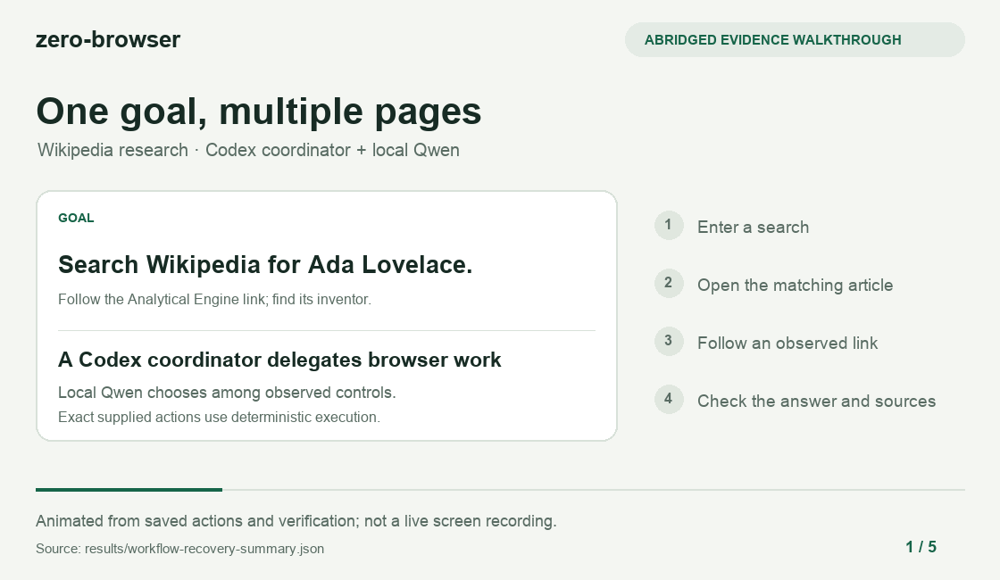

# zero-browser

[](#quickstart)
[](model-lock.json)
[](jev_ultrafast/local_model.py)
[](#connect-to-codex)
[](LICENSE)

Give a browser goal to a local Qwen model. zero-browser observes Chrome, chooses
an action and its target, then checks the page again. Use the CLI or connect it
to Codex through MCP. The browser worker needs no API key; an optional Codex
coordinator runs separately.

**Prototype:** demonstrated tasks below have saved evidence. General reliability,
speed gains, and cost savings remain unproven.

## See an example

[](docs/media/workflow-walkthrough.mp4)

[Watch the 16-second video](docs/media/workflow-walkthrough.mp4) · [Run evidence](results/workflow-recovery-summary.json)

An abridged animation of saved actions and verification, not a live screen
recording. This workflow used a Codex coordinator, local Qwen, and exact supplied
actions in one browser session.

## Demonstrated tasks

| Example | What was verified |
| --- | --- |
| **Navigate:** open Casa Flora on the local hotel fixture. | [Matching URL and page text](results/install-cli-verification.json). |
| **Fill a form:** enter supplied text, select a dropdown, or choose an autocomplete option. | [Fixed field outcomes and safe stops for missing or ambiguous controls](results/bounded-worker-summary.json). |
| **Research:** search Ada Lovelace, follow the Analytical Engine link, and return its inventor with sources. | [Observed route, answer, and supporting URLs](results/workflow-recovery-summary.json). |
| **Search flights:** find an SFO–JFK round trip for one adult in economy. | [One development attempt passed all nine checks; the earlier failure is retained](results/flights-round-trip-development.json). Stops before booking. |

Form tasks use the [bounded-worker interface](scripts/worker_benchmark.py); research and
flight demonstrations use coordinator workflows. These results do not imply that
the standalone CLI or MCP goal tool reliably completes every example.

## Quickstart

Requires an **Apple Silicon Mac with Metal**. The installer sets up locked Python
dependencies and about 2.3 GB of pinned model files. It reuses existing Chrome
or downloads Chrome for Testing if Chrome is absent.

```bash
git clone https://github.com/thomasjhuang/zero-browser.git
cd zero-browser
bash install.sh
./zero-browser --doctor
```

Try the included hotel fixture:

```bash
./zero-browser --fixture \
  --expect-url '#casa-flora' --expect-text 'Casa Flora' \
  "Open Casa Flora."
```

For another site, supply `--url` and one natural-language goal. Add `--expect-url`
or `--expect-text` to check the final page independently. A model `DONE` choice
alone does not prove success. Use `bash install.sh --offline` after caching the
required downloads. Windows, Linux, and Intel Macs are unsupported.

## Connect to Codex

From the repository root after installation:

```bash
codex mcp add zero_browser -- "$PWD/.venv/bin/python" "$PWD/scripts/mcp_server.py"
```

Start a new Codex session. Ask it to call `zero_browser.run_browser_goal` with a
`goal`, starting `url`, and optional `expect_url` or `expect_text` checks. Each call
starts a fresh browser and model worker, then closes them; login state does not
carry over. See the [verified MCP example](results/codex-mcp.json) and
[operation commands](contexts/PROJECT.md).

## How it works

**Page → indexed controls → operation + observed target → execution → observation.**

[Qwen3-4B, quantized to 4 bits](model-lock.json), runs locally through MLX. It
chooses from observed controls rather than writing selectors or browser code.
`TYPE_TEXT` calls a text helper using the same model. The executor checks target
freshness, records mutations before observing their results, and never retries
an uncertain mutation. Time, memory, prompt-size, and single-run limits bound
the worker. See [runtime safeguards](results/cli-runtime-safety.json).

Browser components derive from [Jev Ultrafast](https://github.com/browser-use/jev-ultrafast).
[MIT license](LICENSE) · [Upstream attribution](LICENSE.jev-ultrafast).
